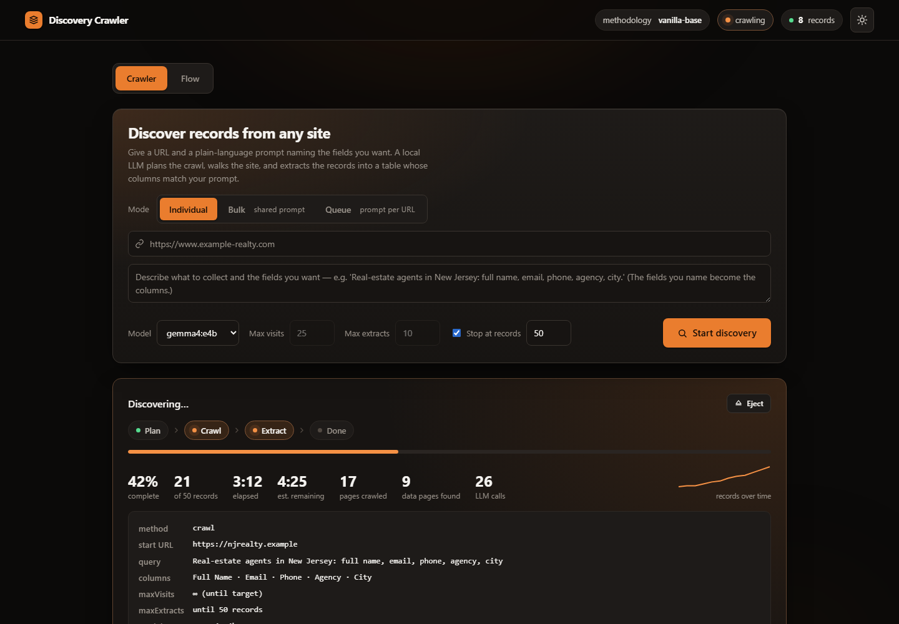
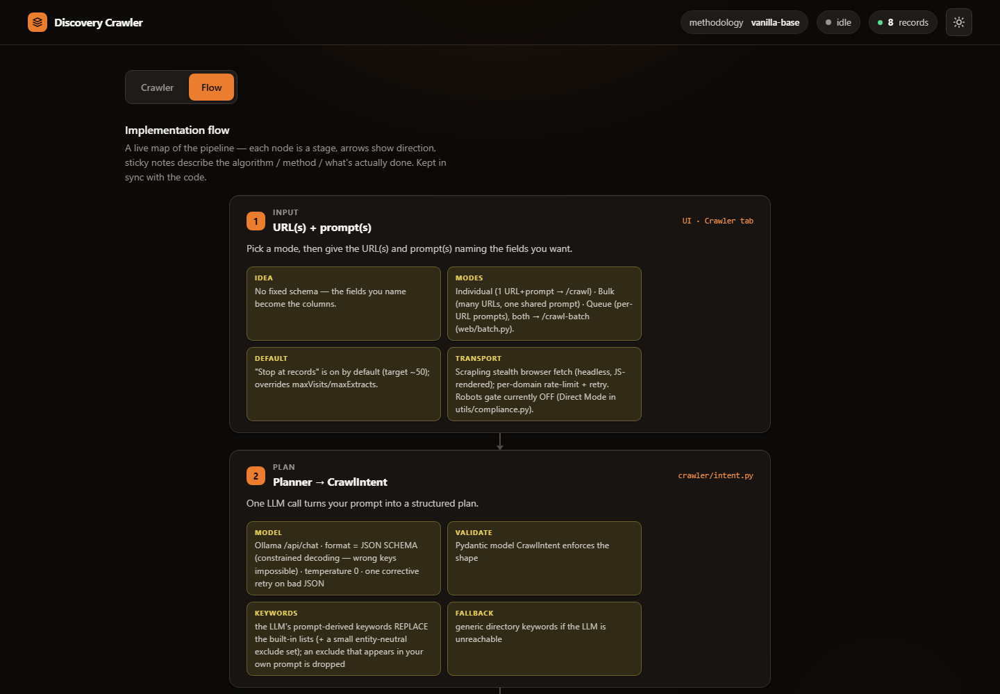
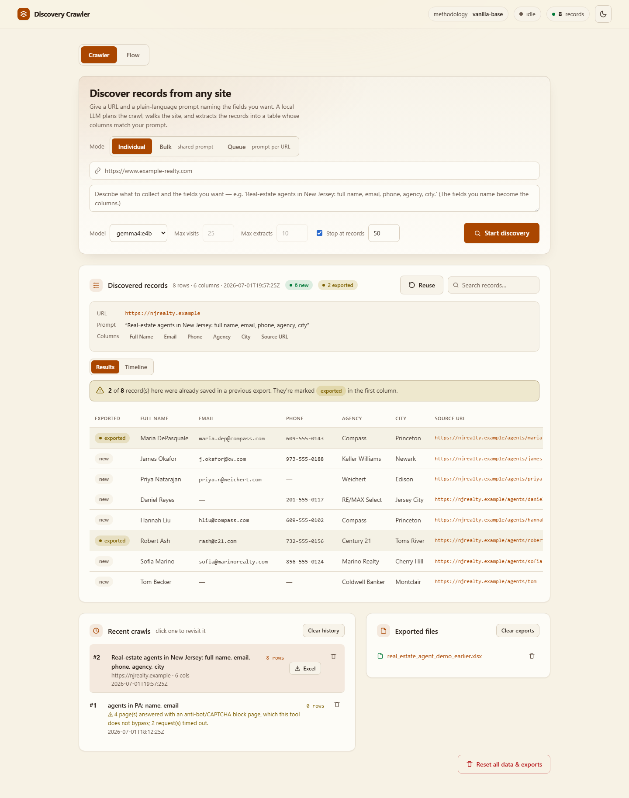
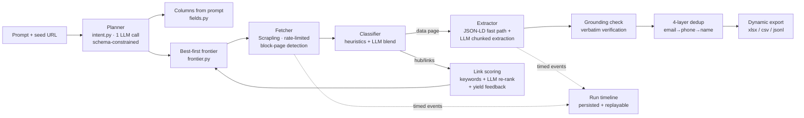

# Discovery Crawler — LLM-guided web data extraction, 100% local


Give it a **seed URL** and a **plain-language prompt** naming the fields you want.
A **local LLM** (Ollama, no external API) plans the crawl, walks the site with a
best-first frontier, classifies pages, extracts the records, and exports them to
Excel/CSV/JSONL — with **columns derived from your prompt**, not a fixed schema.

```text
"Real-estate agents in New Jersey: full name, email, phone, agency, city"
        │
        ▼
┌────────┐   ┌─────────────┐   ┌──────────────────┐   ┌────────────┐   ┌────────┐
│  PLAN  │──▶│   CRAWL     │──▶│    CLASSIFY      │──▶│  EXTRACT   │──▶│ EXPORT │
│ 1 LLM  │   │ best-first  │   │ heuristics + LLM │   │ LLM + JSON │   │  xlsx  │
│  call  │   │  frontier   │   │      blend       │   │ -LD, then  │   │  csv   │
│        │   │             │   │                  │   │ grounding  │   │ jsonl  │
└────────┘   └─────────────┘   └──────────────────┘   └────────────┘   └────────┘
```



---

## Why this project is interesting (AI engineering)

This is not "call GPT on some HTML". Every LLM touchpoint is engineered for
reliability on a small local model (`gemma4:e4b` by default, swappable via
`OLLAMA_MODEL`):

**1. Schema-constrained decoding, everywhere.**
Every LLM call goes through Ollama's `format` parameter with an explicit JSON
Schema ([`src/crawler/llm.py`](src/crawler/llm.py)), so the model *cannot* emit
malformed JSON or invent keys. Temperature 0 for extraction/classification,
0.5 only where breadth is wanted (URL proposal). One bounded corrective retry
on bad output, then a safe fallback — never a crash.

**2. A grounding layer that kills hallucinations.**
After extraction, every value is verified against the actual page text before
it is kept ([`src/crawler/freeform.py`](src/crawler/freeform.py)): emails must
appear verbatim (including de-obfuscated `[at]`/`(at)` variants), phones are
matched digit-wise across separator styles, names need ≥50% token overlap with
the page. Ungrounded values are blanked, not shipped.

**3. LLM plans the crawl — one call, structured output.**
The user's prompt becomes a `CrawlIntent` ([`src/crawler/intent.py`](src/crawler/intent.py)):
target entity, requested fields, URL include/exclude keywords, and the
*segments* the user wants coverage across (states, brands, cities). The fields
you name become the spreadsheet columns ([`src/crawler/fields.py`](src/crawler/fields.py)) —
no template, works for any record type.

**4. Hybrid heuristic + LLM design (graceful degradation).**
Page classification blends deterministic signals (mailto/tel link counts,
JSON-LD persons) with an LLM verdict ([`src/crawler/classifier.py`](src/crawler/classifier.py));
link scoring is keyword-based first, LLM-re-ranked for the top candidates only.
If Ollama is unreachable, every stage falls back to heuristics — the whole test
suite runs with no LLM and no network.

**5. The crawler learns while it crawls.**
Best-first priority frontier with canonicalized URLs ([`src/crawler/frontier.py`](src/crawler/frontier.py)):
it clusters candidate links, has the LLM pick which URL shape is a "record
detail page", validates that guess against the first fetched match, and
un-learns it if wrong ([`src/crawler/discovery.py`](src/crawler/discovery.py)).
Productive URL shapes get score boosts from actual record yield; sterile ones
get penalized. Sitemap probing is a rescue path, pagination follows
`rel=next`, and on the seed page the LLM can propose sibling URLs for
under-covered segments (e.g. the other states you asked for).

**6. Structured data as a fast path.**
`schema.org` JSON-LD is parsed first ([`src/crawler/jsonld.py`](src/crawler/jsonld.py))
and merged with LLM output by name-token matching — reliable contact data with
zero LLM cost when sites provide it, with person/org/site prioritization so
page furniture never hijacks a record.

**7. Measured, not vibes.**
A benchmark harness ([`scripts/bench_extraction.py`](scripts/bench_extraction.py))
runs the real extractor against golden fixtures (rosters, detail pages, a
high-complexity Zillow profile) and reports **per-field precision/recall** and
record-recall, with type-aware normalization and Jaccard row pairing.

**8. Full observability.**
Every LLM call and page visit emits a timed event; runs render a live
plan + progress + ETA + records sparkline, and the full timeline is persisted
per run and replayable from history — failed runs keep their partial timeline
plus an error diagnosis. The **Flow** tab is a live diagram of the pipeline,
kept in sync with the code.

**9. Deterministic 4-layer dedup.**
Identity key `email → phone → name(+location)` ([`src/crawler/dedup.py`](src/crawler/dedup.py)),
applied within a page, per run, across bulk batches, and against previously
exported files — the UI flags records you already have.

---

## UI

| Live pipeline map (Flow tab) | Day theme |
|---|---|
|  |  |

Three crawl modes (Individual / Bulk / Queue), batch combining, an Eject button
that stops a run but keeps partial results, and a replayable per-run timeline.

## Quick start (Docker)

```bash
cp .env.example .env
docker compose up -d ollama    # local LLM (one-time model pull)
docker compose up ui           # http://localhost:5000 → "Crawler" tab
```

Paste a URL, describe what you want and the fields, click **Start discovery**.
Records render live and export to Excel.

### CLI

```bash
docker compose run --rm scraper crawl \
  --url https://www.example.com \
  --prompt "agents: full name, email, phone, agency, city" \
  --max-pages 40 --max-extracts 10 --extract --export
```

## Architecture



## Repository layout

```
src/crawler/         planner (intent), frontier, classifier, discovery loop,
                     free-form extractor, grounding, JSON-LD, dedup, sitemap,
                     URL-pattern learning, SQLite store, Ollama client
src/sources/base.py  fetcher (rate limit + bounded retry + block-page detection)
src/extractors/      HTML → LLM-ready signal text (contact markers, chunking)
src/exporters/       dynamic exporter (columns from the prompt)
src/web/             Flask UI (Crawler + Flow tabs), batch runner
scripts/             extraction benchmark + golden set, UI screenshot harness
config/              polite-fetch settings (delays, retries, UA)
tests/               151 tests — all run offline with no LLM
```

## Testing

```bash
python -m pytest        # 151 tests, no network/LLM required
```

Covered: crawl loop, frontier scoring, URL canonicalization, detail-pattern
learning, pagination, sitemap rescue, LLM schema wiring, grounding, dedup
layers, batch jobs, exports, the Flask routes, and eight regression tests from
a dedicated silent-failure audit. Extraction *quality* is measured separately
by the golden-set benchmark.

## Responsible crawling

The fetcher reads only publicly reachable pages, keeps a 4–6 s per-domain
delay, stays same-domain, and detects-but-never-solves CAPTCHAs and block
pages. It does not log in, bypass paywalls, or use proxies. The full
code-level account of the current posture (including how to re-enable the
strict `robots.txt` gate) is in
[`LEGALITY_OF_THE_CRAWL.md`](LEGALITY_OF_THE_CRAWL.md).

## Design docs

The project was built spec-first; the design documents and implementation
plans are in [`docs/design-history/`](docs/design-history/), and the detailed
technical design is in [`docs/PHASE1_CRAWLER.md`](docs/PHASE1_CRAWLER.md).

## Stack

Python 3.10 · Flask · Ollama (local `gemma4:e4b`) · Scrapling (fetch + parse) ·
BeautifulSoup fallback · SQLite · Playwright (screenshot harness) · Docker Compose
